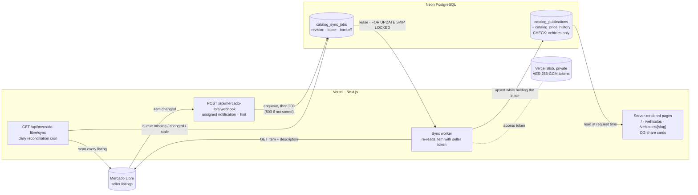
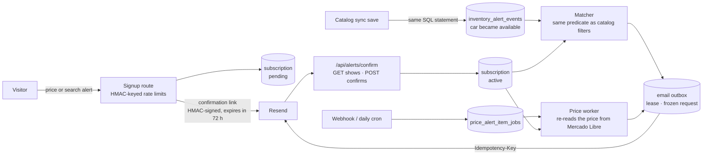

# Gonba's Garage

A production website for a used-car dealer in Buenos Aires. The seller manages their stock in
Mercado Libre, and the site keeps its own copy in sync automatically. Visitors can browse and
compare cars, sign up for price-drop and saved-search email alerts, and ask for a valuation of a car
they want to sell.
Each car keeps a stable page after it is reserved or sold.

**Live:** [gonbagarage.com.ar](https://gonbagarage.com.ar)

<!--
TODO(screenshots): add real captures of the production site once the final version launches, then
uncomment.
Suggested files: docs/screenshots/home.png, docs/screenshots/catalog.png,
docs/screenshots/vehicle.png, docs/screenshots/alert-email.png. Do not use mock vehicles.

| Home | Catalog | Vehicle page |
| --- | --- | --- |
|  |  |  |
-->

## At a glance

- **Real inventory with no manual data entry.** Mercado Libre stays the source of truth. Webhooks
  and a daily reconciliation keep a Postgres copy up to date, so pages never call Mercado Libre
  while rendering.
- **Correctness under unreliable inputs.** Webhook notifications are unsigned, so they are only
  treated as hints to re-read the item. The job queue uses revisions and leases. Reconciliation
  never deletes anything, and the database rejects anything that is not a car, pickup or
  motorcycle.
- **Alert emails without duplicates or abuse.** Signups use double opt-in with signed, expiring
  links and hashed rate limits. Emails go through a leased outbox with frozen request bytes and
  provider idempotency keys.
- **Search indexing is held back on purpose.** Indexing stays off and the sitemap stays empty until
  the final launch. Social share previews already work.

## Stack

| Layer | Choice |
| --- | --- |
| Framework | Next.js 16 App Router, React 19 Server Components, TypeScript |
| Styling and motion | Hand-written CSS with design tokens ([`styles/tokens.css`](styles/tokens.css)), GSAP as progressive enhancement, self-hosted Geist fonts |
| Data | Neon serverless PostgreSQL, plain SQL migrations ([`database/migrations/`](database/migrations)) |
| Hosting | Vercel (Hobby plan): functions, cron jobs, private Blob storage |
| Integrations | Mercado Libre API (OAuth 2.0 + PKCE), Resend (email), PostHog (analytics), DolarAPI (MEP exchange rate), Arg Autos (make/model catalog for the sell-your-car form) |
| Testing | Scripted checks in [`scripts/`](scripts), with SQL run against in-memory PostgreSQL (PGlite) |

## Architecture

### Inventory sync



### Alerts



The full design lives in [docs/architecture.md](docs/architecture.md), with alert delivery in
[docs/price-alert-delivery.md](docs/price-alert-delivery.md).

## Key engineering decisions

**Pages read a synced copy, never Mercado Libre directly.**
Every page and the share-image route read through one boundary,
[`lib/integrations/mercado-libre/catalog.ts`](lib/integrations/mercado-libre/catalog.ts), which reads
[`lib/catalog/store.ts`](lib/catalog/store.ts). Traffic, crawlers and share previews therefore never
use up API quota or wait on the provider. *Trade-off:* on the Hobby plan, the cron that repairs a
missed notification only runs once a day, so the copy can be up to a day stale until the next run.
On a Pro plan, a one-line schedule change in [`vercel.json`](vercel.json) brings that down to 15
minutes.
([architecture: Mercado Libre sync](docs/architecture.md#mercado-libre-sync))

**Webhooks are only hints.** Mercado Libre notifications are unsigned. The
[webhook](app/api/mercado-libre/webhook/route.ts) checks the seller ID, application ID, topic and
resource shape, stores the item ID in the queue and only then answers 200. If the job cannot be
stored, it answers 503 so Mercado Libre retries. The worker then re-reads the item with the
seller's token, so a forged, duplicated or out-of-order notification cannot write wrong data.
*Trade-off:* every notification costs one extra API read.

**A Postgres job queue instead of a queue service.** [`catalog_sync_jobs`](database/migrations/20261031_catalog_sync.sql)
has one row per item, with a revision counter: a notification that arrives during a read makes the
item due again. Workers claim jobs with `FOR UPDATE SKIP LOCKED` and a time-limited lease. A write is
only accepted while the worker still holds that lease, failures back off exponentially up to an hour,
and a job is given up after eight attempts with the error kept for diagnostics. *Trade-off:* the
queue is drained inside `after()` and the cron instead of by long-running consumers. That is enough
for a single dealer's stock and needs no extra infrastructure.

**Reconciliation never deletes.** [`reconcileCatalog`](lib/integrations/mercado-libre/inventory-sync.ts)
compares every listing the seller has, in any status, with the copy, and only queues items for a
fresh read. As a result, a partial or empty provider response cannot remove cars from the site. It
also backfills cars that were paused or closed before the copy existed, so every car the seller
has ever listed keeps a page.

**The database decides what counts as a vehicle.** Only cars, pickups and motorcycles are stored,
based on the Mercado Libre category tree. A CHECK constraint
([`20261102_catalog_vehicle_category.sql`](database/migrations/20261102_catalog_vehicle_category.sql))
mirrors [`vehicle-categories.ts`](lib/integrations/mercado-libre/vehicle-categories.ts), so no code
path can store the seller's scale models or accessories. *Trade-off:* the category list lives in two
places, and both must be changed together.

**Fail closed with one-use refresh tokens.** OAuth uses PKCE (S256) and a state value compared in
constant time. The callback and every token refresh check that the token belongs to the expected
seller. Tokens are encrypted with AES-256-GCM, using the seller ID as associated data, and stored in
a private Vercel Blob. Rotation is a compare-and-swap on the blob's ETag: only one instance can lock
and renew, and the others wait for its result. If a renewal ends ambiguously, the lock stays in
place and the site needs a manual re-authorization, rather than reusing a token Mercado Libre may
already have consumed.
([`refresh-token-store.ts`](lib/integrations/mercado-libre/refresh-token-store.ts),
[storage and concurrency notes](docs/mercado-libre-local.md#almacenamiento-y-concurrencia))

**Alert emails: at most once, not at least once.** Each alert type uses its own HMAC-signed token
format, so a confirmation token can never work as a cancellation token. Confirmation links expire.
Requesting a link (GET) never changes anything, so email link scanners cannot confirm or cancel
alerts, and cancellation also supports RFC 8058 one-click unsubscribe. Each email request is frozen
before its first send and retried with the same Resend idempotency key. If a send was possibly
accepted and the provider's 24-hour deduplication window has passed, the email is never resent.
Alerts are only offered where email can actually be sent, with no separate feature flag.
([alert delivery](docs/price-alert-delivery.md), [`lib/alerts/`](lib/alerts))

**Stable URLs through the whole listing lifecycle.** A car's slug is fixed at its first sync. Any
other slug ending in the same listing ID gets a permanent redirect. Paused and closed listings keep
their page, labeled reserved or sold, with links to similar available cars instead of a 404.
([SEO guidelines: inventory lifecycle](docs/seo-and-social-metadata.md#inventory-lifecycle-and-indexing))

**Search indexing as a deliberate launch gate.** `SITE_INDEXING_ENABLED` defaults to `false`. On
top of that, a catalog hold in code keeps `/vehiculos`, car pages and the sitemap out of search
results until the final version ships, so the sitemap is empty on purpose for now. Open Graph and
share cards keep working in the meantime.
([indexing gates](docs/seo-and-social-metadata.md#indexing-gates-and-permanent-domain-policy))

**No demo vehicles, anywhere.** Every environment shows the real catalog. Local development reads
it from the deployed backend through a key-protected endpoint, and tests use their own fixtures,
which the app never imports. *Trade-off:* local development needs that key, but nothing fake can
ever ship. ([local setup](docs/mercado-libre-local.md#desarrollo-local))

**Content first, motion as an extra.** Prices, vehicle data and contact actions are
server-rendered and work without JavaScript animation. Motion follows `prefers-reduced-motion`.
([design system](docs/design-system.md), [performance budget](docs/performance-budget.md))

## Local development

Requires Node.js 22.13 or newer.

```bash
npm install
cp .env.example .env.local   # fill in what you have; never commit real values
npm run dev
```

To see real cars locally, keep `MERCADO_LIBRE_BACKEND_URL` from `.env.example` and add the private
`MERCADO_LIBRE_CATALOG_API_KEY`. The local server then reads the catalog from the deployed backend,
with no Mercado Libre credentials needed on your machine ([setup notes](docs/mercado-libre-local.md#desarrollo-local)).
`DATABASE_URL` is server-only and is needed for alerts and for reading a catalog copy directly from
Neon. `npm run db:migrate` applies pending migrations in file-name order and records each one in
`schema_migrations` ([adding a migration](docs/neon-alert-storage.md#adding-a-migration)).

## Quality checks

```bash
npm run lint
npm run typecheck
npm run build
```

[CI](.github/workflows/ci.yml) runs these three checks on every pull request. Domain checks for the
sync, token store, alerts and metadata contract are the `test:*` scripts in
[`package.json`](package.json).

## Project structure

```text
app/                      Routes, layouts and thin route handlers (route-only UI in _components/)
  api/mercado-libre/      OAuth connect/callback, webhook, sync cron, catalog, diagnostics
  api/*alerts/            Price and search alert signup, confirmation, cancellation, daily cron
  og/vehiculos/[slug]/    Generated 1200×630 share card per vehicle
components/               Shared UI primitives, layout, brand, motion and SEO components
features/vehicles/        Vehicle domain model, Mercado Libre mapper, presentation rules
lib/integrations/         Server-only adapters: Mercado Libre, Arg Autos, MEP quote
lib/catalog/              Synced catalog store and sync job queue (SQL)
lib/alerts/               Alert subscriptions, signed tokens, rate limits, outbox workers, email
database/migrations/      Versioned SQL migrations, tracked in schema_migrations
scripts/                  Migration runner and check-*.mjs test suites
docs/                     Architecture, SEO, alerts, design system and operations notes
```

## Documentation

- [Architecture](docs/architecture.md): routes, sync design and response headers
- [SEO and social metadata](docs/seo-and-social-metadata.md): binding rules for every public route
- [Alert delivery](docs/price-alert-delivery.md) and [Neon storage](docs/neon-alert-storage.md)
- [Mercado Libre setup](docs/mercado-libre-local.md) (in Spanish) and
  [connection diagnostics](docs/mercado-libre-connection-diagnostics.md)
- [Design system](docs/design-system.md), [performance budget](docs/performance-budget.md),
  [analytics](docs/analytics.md), [vehicle attribute policy](docs/vehicle-attribute-policy.md)
- [Custom-domain launch checklist](docs/custom-domain-launch-checklist.md)

## License

All rights reserved. Code shared for portfolio review. Brand, logos and content belong to Gonba's
Garage. The bundled Geist fonts keep their own SIL Open Font License (`app/fonts/`).
